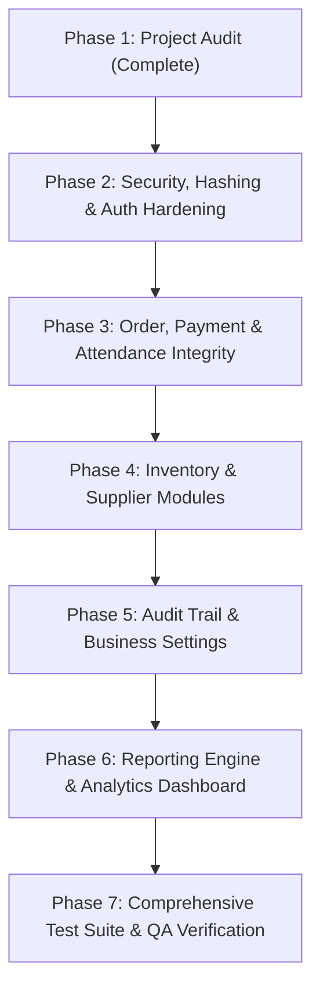

# 📋 Smart Mess & Canteen Management System — Production Implementation Plan

**Document Version:** 1.0.0  
**Date:** October 26, 2026  
**Status:** Ready for Review & Step-by-Step Execution  
**Target Architecture:** Production-Style Spring Boot 4.x / Java 21 + Angular 21 + MySQL 8.0

---

## 1. Architectural Principles & Constraints

1. **Preserve Working Functionality:** Do not discard, replace, or break existing working endpoints, forms, or views.
2. **Incremental & Verifiable Progress:** Each change is implemented in small, isolated steps with immediate build and runtime verification.
3. **Defense-in-Depth Security:** Passwords must be hashed (BCrypt), sensitive fields must never leak over REST endpoints, and backend route protection must be strictly enforced.
4. **Data Integrity & Coupling:** Orders and Subscriptions must generate tracked Payment transactions; attendance check-ins must enforce subscription validity and prevent duplicate check-ins.
5. **No Destructive Operations:** Never drop tables or delete student/admin data without explicit permission.

---

## 2. Priority Ranking & Dependency Graph



| Phase | Module / Area | Priority | Risk Level | Primary Dependencies |
| :--- | :--- | :--- | :--- | :--- |
| **Phase 2** | Security & Auth Hardening (BCrypt, DTOs, Password Protection) | 🔴 P0 (Critical) | Medium | None |
| **Phase 3** | Order-Payment Coupling, State Machine & Attendance Constraints | 🔴 P0 (Critical) | Medium | Phase 2 |
| **Phase 4** | Inventory, Stock Movements & Suppliers | 🟡 P1 (High) | Low | Phase 3 |
| **Phase 5** | Audit Trail & Business Settings | 🟡 P1 (High) | Low | Phase 3, 4 |
| **Phase 6** | Reports Engine, CSV Exports & Dashboard Analytics | 🟢 P2 (Medium) | Low | Phase 3, 4, 5 |
| **Phase 7** | Frontend UX Polish, Error Modals & Role Visibility | 🟢 P2 (Medium) | Low | All Phases |
| **Phase 8** | Backend Unit/Integration Tests & Documentation Completion | 🟢 P2 (Medium) | Low | All Phases |

---

## 3. Phased Implementation Roadmap

---

### 🛡️ Phase 2: Security, Hashing & Authentication Hardening

#### Step 2.1 — Password Hashing with BCrypt
- **Goal:** Eliminate plaintext passwords in the database.
- **Backend Changes:**
  - Add `spring-security-crypto` (or `BCryptPasswordEncoder`) utility.
  - Implement transparent password hashing on registration (`StudentServiceImpl.createStudent`, `AdminServiceImpl.createAdmin`).
  - Upgrade login verification to use `passwordEncoder.matches(raw, encoded)` while maintaining backwards compatibility for existing seed accounts.
- **Verification:** Unit test hashing and verify existing seed accounts authenticate successfully.

#### Step 2.2 — Sensitive Data Masking & DTOs
- **Goal:** Prevent leaking passwords over REST APIs.
- **Backend Changes:**
  - Add `@JsonProperty(access = JsonProperty.Access.WRITE_ONLY)` to `Admin.password` and `Student.password`.
  - Create `LoginRequest`, `LoginResponse`, `AdminDTO`, `StudentDTO` to strictly define input/output contracts.
- **Verification:** Call `GET /api/students` and `GET /api/admins` via REST and verify the `password` field is omitted from JSON responses.

#### Step 2.3 — Environment Configuration for Secrets
- **Goal:** Remove hardcoded credentials from source control.
- **Backend Changes:**
  - Update `application.properties` to support environment variable injection with safe defaults:
    ```properties
    spring.datasource.url=${DB_URL:jdbc:mysql://localhost:3306/smart_mess_db}
    spring.datasource.username=${DB_USERNAME:root}
    spring.datasource.password=${DB_PASSWORD:7447Swati@}
    ```
- **Verification:** Application starts normally with and without environment overrides.

---

### 💳 Phase 3: Financial Coupling, State Machine & Data Integrity

#### Step 3.1 — Order & Subscription Payment Coupling
- **Goal:** Automatic ledger reconciliation when transactions occur.
- **Backend Changes:**
  - When an order is placed (`FoodOrderServiceImpl.createOrder`), automatically generate a `Payment` record with type `CANTEEN_ORDER`, amount equal to `order.totalAmount`, status `COMPLETED` (or `PENDING` if cash-on-pickup), and unique transaction ID (`TXN-ORD-...`).
  - When a subscription is purchased (`SubscriptionServiceImpl.createSubscription`), generate a `Payment` record with type `SUBSCRIPTION`.
- **Frontend Changes:**
  - Add payment method selector (Online / UPI / Cash) in `student-order` and `student-subscription` forms.
- **Verification:** Place an order in UI; verify a linked `Payment` record appears in `/payments`.

#### Step 3.2 — Order State Machine & Cancellation Rules
- **Goal:** Prevent invalid status transitions and enable rule-based cancellation.
- **Backend Changes:**
  - Add `PREPARING` to `OrderStatus` enum (`PENDING` ➔ `CONFIRMED` ➔ `PREPARING` ➔ `READY` ➔ `DELIVERED`).
  - Enforce status transition validation: disallow transition from `DELIVERED` or `CANCELLED` to prior states.
  - Add student cancellation endpoint: orders can only be cancelled while in `PENDING` status.
- **Frontend Changes:**
  - Add "Cancel Order" button in `student-orders` (active only when status is `PENDING`).
- **Verification:** Attempt invalid transitions via API (verify HTTP 400 Bad Request); test student cancellation in UI.

#### Step 3.3 — Attendance Integrity & Duplicate Prevention
- **Goal:** Ensure only subscribed students check in and prevent double-counting.
- **Backend Changes:**
  - In `AttendanceServiceImpl.createAttendance`, check if student has an `ACTIVE` subscription covering the current date.
  - Check if attendance already exists for `(studentId, mealId, attendanceDate)`. If already present, return informative conflict status (`409 Conflict`).
  - Add database unique constraint or repository check: `existsByStudentIdAndMealIdAndAttendanceDate`.
- **Verification:** Attempt logging attendance twice for the same student, meal, and date; verify rejection.

---

### 📦 Phase 4: Inventory & Procurement Management

#### Step 4.1 — Inventory Entity & Repository Setup
- **Goal:** Track kitchen raw materials, ingredients, and pre-packaged goods.
- **Backend Entities:**
  - `InventoryItem`: `id`, `name`, `category` (GRAINS, VEGETABLES, DAIRY, SPICES, PACKAGED), `quantity`, `unit` (KG, LITRE, PACKET), `minimumThreshold`, `unitCost`, `updatedAt`.
  - `StockMovement`: `id`, `inventoryItem`, `type` (PURCHASE, USAGE, WASTAGE), `quantity`, `reason`, `movedAt`, `recordedBy`.
- **Backend Services & API:**
  - Full CRUD on `/api/inventory`
  - Stock adjustment endpoint: `/api/inventory/{id}/adjust`
  - Low-stock warning endpoint: `/api/inventory/low-stock`

#### Step 4.2 — Inventory Admin UI
- **Frontend Views:**
  - `inventory-list`: Table with current stock, unit, category badge, and warning indicator for low stock.
  - `inventory-add` / `inventory-adjust`: Modal/form to record stock additions, kitchen consumption, or wastage.
  - Add to Admin Sidebar navigation under "Operations".
- **Verification:** Add an inventory item, record usage, verify low-stock alert triggers when quantity drops below threshold.

#### Step 4.3 — Suppliers Module (Optional / Phase 4 Extension)
- **Goal:** Vendor directory and procurement tracking.
- **Backend Entities:**
  - `Supplier`: `id`, `name`, `contactPerson`, `phone`, `email`, `address`, `category`.
- **Endpoints & UI:**
  - `/api/suppliers` CRUD with Admin supplier management view.

---

### 📜 Phase 5: Audit Trail & System Settings

#### Step 5.1 — Audit Trail Logging
- **Goal:** Compliance and accountability for administrative modifications.
- **Backend Entity:**
  - `AuditLog`: `id`, `actorEmail`, `actorRole`, `action` (e.g. `UPDATE_PRICE`, `RESOLVE_COMPLAINT`, `CANCEL_ORDER`), `entityName`, `entityId`, `details`, `timestamp`.
- **Backend Interceptor / Service:**
  - Service methods record audit events on critical state changes.
- **Frontend View:**
  - `audit-log-list` in Admin communication section.

#### Step 5.2 — System Settings & Business Rules
- **Goal:** Configurable application parameters without code changes.
- **Backend Entity:**
  - `SystemSetting`: `key`, `value`, `description`, `category` (MESS, BILLING, ORDERS).
  - Configurable properties: Tax/GST percentage, order cancellation window (minutes), default meal prices, late fee percentage.
- **Frontend View:**
  - Admin Settings screen to edit system parameters.

---

### 📊 Phase 6: Reporting Engine & Analytics Dashboard

#### Step 6.1 — Server-Side Aggregation Queries
- **Goal:** Replace in-memory dashboard calculations with optimized SQL aggregations.
- **Backend Repository Queries:**
  - Total sales and revenue by date range: `SELECT SUM(totalAmount) FROM FoodOrder WHERE orderedAt BETWEEN :start AND :end`
  - Active subscription revenue.
  - Meal attendance distribution per mess.
- **Backend Controller:** `/api/reports/dashboard-summary`, `/api/reports/sales-daily`, `/api/reports/popular-items`.

#### Step 6.2 — Reports UI & CSV Export
- **Frontend Views:**
  - Reports tab in Admin with date picker (Today, This Week, This Month, Custom).
  - Export to CSV button for order history, payment summaries, and attendance records.
- **Verification:** Generate report, verify aggregated counts match database, download and inspect CSV.

---

### 🧪 Phase 7: Testing, Documentation & Final Delivery

#### Step 7.1 — Automated Test Suite
- **Backend Tests:**
  - `AuthenticationServiceTest`: Password hashing and authentication flows.
  - `FoodOrderServiceTest`: Order creation, automatic payment generation, and invalid status transition rejections.
  - `AttendanceServiceTest`: Duplicate check-in rejection and subscription validation.
  - `InventoryServiceTest`: Stock deduction and threshold alerts.
- **Frontend Tests:**
  - Guard and component spec execution via `npm test`.

#### Step 7.2 — Documentation Deliverables
- `docs/PROJECT_AUDIT.md` (Completed in Phase 1)
- `docs/IMPLEMENTATION_PLAN.md` (Completed in Phase 1)
- `docs/SETUP_GUIDE.md` (Prerequisites, configuration, DB setup, launch instructions)
- `docs/API_DOCUMENTATION.md` (Full endpoint catalog with request/response schemas)
- `docs/TEST_REPORT.md` (Test execution log, assertions passed, and defect remediation log)

---

## 4. Exact First Recommended Fix

### 🎯 Step 1: Security & Password Protection Hardening
1. **Mask Sensitive Fields in JSON:**
   Add `@JsonProperty(access = JsonProperty.Access.WRITE_ONLY)` to `Admin.password` and `Student.password` so passwords are never transmitted in `GET` responses.
2. **Implement Password Hashing:**
   Configure `BCryptPasswordEncoder` in Spring context and update `AdminServiceImpl` & `StudentServiceImpl` to hash passwords upon registration and verify credentials using BCrypt (with graceful legacy plaintext fallback for existing seed accounts so existing logins continue to work uninterrupted).
3. **Environment Property Fallbacks:**
   Add `${DB_PASSWORD:...}` environment variable support to `application.properties`.

**Expected Outcome:**
- Zero risk of password leakage across all REST endpoints.
- All stored passwords securely protected with standard BCrypt.
- Existing database users (`admin@smartmess.com` / `admin123` and `paliwalswati603@gmail.com` / `123456`) remain 100% operational.
